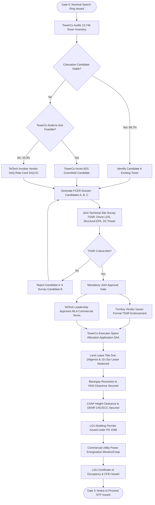
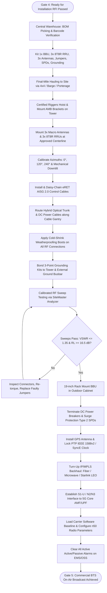
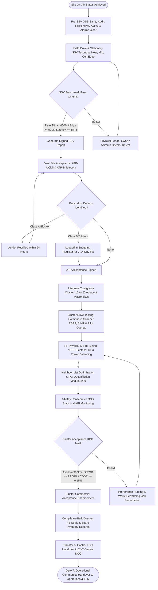
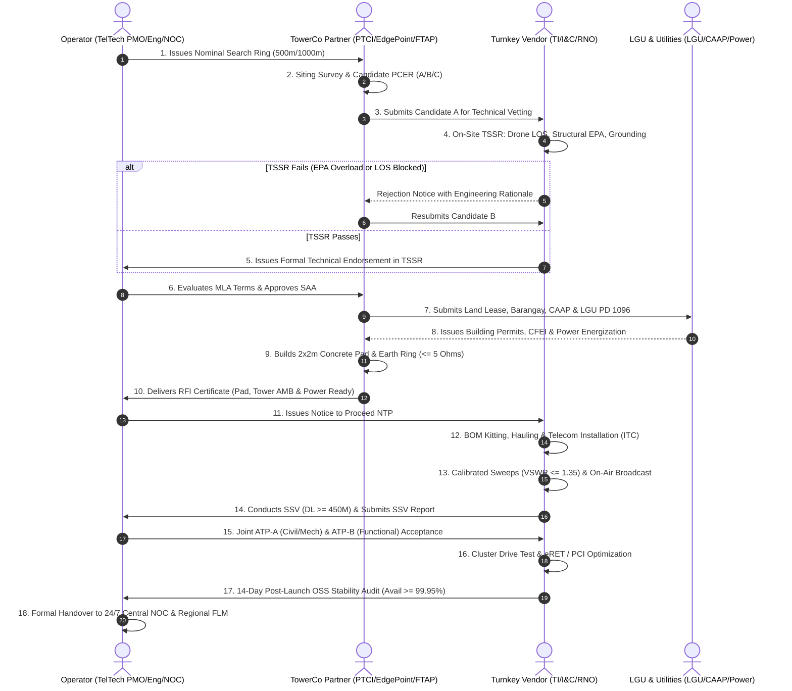

# TELTECH 5G FIXED WIRELESS ACCESS (FWA) PROGRAM
## NATIONWIDE DEPLOYMENT & OPERATIONS IMPLEMENTATION PLAYBOOK
**From Siting, Acquisition & Permitting to Commissioning, Optimization & 24/7 Managed NOC Operations**

* **Document Code:** TTSI-ENG-PLY-2026-001
* **Classification:** STRICTLY CONFIDENTIAL — INTERNAL TELTECH MANAGEMENT ONLY
* **Target Audience:** Board of Directors, Executive Committee, PMO, Engineering, Rollout, and Operations Leadership
* **Version:** 1.0 (Comprehensive Leadership Edition)
* **Date:** October 2026

---

## 1. EXECUTIVE PROGRAM MANDATE & SITING ARCHITECTURE

### 1.1 Program Scale & Objectives
Telecommunications Technology Solutions, Inc. (TELTECH) is deploying a carrier-grade 5G Fixed Wireless Access (FWA) network across the Philippines. Operating on 3GPP Band n50 (1432–1517 MHz, 60 MHz TDD) under Republic Act No. 10182 and NTC Provisional Authorities (Case Nos. 2017-084 and 2017-291), the program is engineered to provide fiber-like wireless broadband to unserved, underserved, and GIDA barangays, while aggressively capturing market share in suburban residential clusters.

* **Phase 1 Baseline:** 1,000 Macro Sites nationwide within 365 calendar days.
* **Full Program Horizon:** 5,000 Macro Sites nationwide across Phases 2 through 5.
* **Statutory Mandate:** 70:30 ratio of urban to suburban/rural coverage per rollout phase. TELTECH treats this requirement as a minimum operational baseline.

### 1.2 The 3-Tier Siting Sourcing Hierarchy
To balance aggressive time-to-market against capital efficiency, TELTECH enforces a strict 3-tier sourcing hierarchy across all 5,000 sites:

1. **Tier 1: TowerCo Co-Location (Mandatory Baseline - 89.7% / 897 Sites):**
   - Primary sourcing mechanism leveraging audited inventories of licensed Independent Tower Companies (TowerCos) — Phil-Tower Consortium (PTCI/MIDC), EdgePoint Philippines, Frontier Tower Associates Philippines (FTAP Globe & Smart), and LBC Digital (LDIC) across 13,746 existing operational towers.
   - Capital expenditure avoidance: Saves over $721 Million in cumulative structural civil works across the 10-year network lifecycle.
2. **Tier 2: TowerCo Build-to-Suit / B2S (Secondary Target):**
   - Utilized where existing towers lack structural load capacity (Effective Projected Area - EPA) or fail RF Line-of-Sight (LOS) criteria, but fall within a commercial TowerCo search footprint.
3. **Tier 3: Direct Operator Greenfield Monopole (Restricted Exception - 10.3% / 103 Sites):**
   - Strict exception handling reserved for unserved remote search rings where zero TowerCos operate, or where all TowerCos issue formal structural denial letters.

### 1.3 Governance: TowerCo-Led SAQ Scope vs. Vendor Contingency Rate Card
* **Primary Baseline (TowerCo Scope):** All physical site hunting, landlord lease negotiation, title due diligence, Barangay resolutions, HOA clearances, LGU building permits, CAAP height permits, and commercial power applications are **STRATEGICALLY THE SCOPE AND FINANCIAL OBLIGATION OF THE TOWERCO** under Master Lease Agreements (MLA). Bidders and rollout contractors shall NOT embed site acquisition or permitting markups in their baseline installation pricing.
* **Mandatory Joint Approval Gate:** Physical candidate hunting is conducted by the TowerCo. However, approval is strictly governed by a joint gate: (1) Turnkey Vendor conducts on-site technical vetting (RF LOS, antenna height, structural EPA headroom, DC power, cable tray routing) and issues technical endorsement in the TSSR; (2) TELTECH Leadership evaluates commercial terms under MLA and issues final sign-off.
* **Vendor SAQ Standby Rate Card (SAQ-01 to SAQ-08):** Evaluated strictly as a standby contingency rate card in the commercial price book for Tier 3 Operator Greenfield Own-Build sites. Billable only upon formal written Work Order issued by TELTECH.

---

## 2. THE 8-GATE TURNKEY IMPLEMENTATION PIPELINE

| Gate | Milestone Name | Primary Owner | Mandatory Entry Criteria | Deliverable & Exit Gate Sign-Off |
| :--- | :--- | :--- | :--- | :--- |
| **Gate 0** | Nominal Siting & Search Ring | RAN Planning | Clutter database & demand polygon | Nominal Search Ring Issued (500m urban / 1km rural) |
| **Gate 1** | Candidate Siting & PCER | TowerCo / SAQ | Search Ring Dossier | Preliminary Candidate Evaluation Report (PCER: A/B/C) |
| **Gate 2** | Technical Site Survey (TSSR) | Vendor & Eng. | Candidate A Selection | Drone 360°, TIA-222-H Structural & Grounding TSSR |
| **Gate 3** | SAA, Permitting & Lease (NTP) | TowerCo & PMO | Approved TSSR | TowerCo SAA Approval, LGU Permits, Executed Lease, NTP |
| **Gate 4** | Civil, Tower AMB & Power (RFI) | TowerCo / Civil | Issued NTP | 2x2m Pad, Grounding <= 5Ω, DC Power, RFI Certificate |
| **Gate 5** | Telecom Installation (ITC) | I&C Vendor | Signed RFI | 3x 8T8R RRU, Antennas, Sweeps (VSWR <= 1.35:1), TI Checklist |
| **Gate 6** | On-Air, SSV & Site Acceptance | QA / Vendor | Commissioned BTS | IP Backhaul Sync, SSV Report (DL >= 450M), ATP-A/B Sign-Off |
| **Gate 7** | Cluster RNO & Operations Handover| RNO & Ops | Contiguous 10-20 Sites On-Air | 14-Day OSS Stability (Avail >= 99.95%), TOC Handover to NOC |

---

## 3. FLOWCHARTS FOR EVERY MAJOR IMPLEMENTATION STEP

### 3.1 Flowchart 1: Site Acquisition (SAQ) & Statutory Permitting Detailed Workflow

### 3.2 Flowchart 2: Telecom Installation, Testing & Commissioning (ITC) Detailed Workflow

### 3.3 Flowchart 3: Radio Network Optimization (SSV & Cluster RNO) Detailed Workflow

### 3.4 Flowchart 4: Multi-Party End-to-End Governance Swimlane

---

## 4. TELTECH ORGANIZATIONAL STRUCTURE & GOVERNANCE

Extracted directly from the official **TTSI-ISMS-MNL-001 Manual (Teltech)**, the table below outlines the 14 functional branches governing the rollout, operation, and security of the nationwide 5G FWA network:

### TELTECH Corporate Table of Organization
**Leadership:** Board of Directors & President / CEO  
**Mandate:** High-level corporate governance framework encompassing the Board of Directors, President & CEO, and the three executive pillars: Technology & Operations, Commercial & Strategy, and Corporate Services & Governance.  
**Reference Chart:** `assets/org_charts/image10.png`  

* **Executive & Governance:**  Office of the President & CEO, Legal & Regulatory, CISO / Information Security Office, Internal Audit
* **Technology & Operations:**  Chief Technology Officer (CTO), Head of Network Rollout, Head of Network Operations, Chief Information Officer (CIO)
* **Commercial & Strategy:**  Chief Strategy Officer (CSO), Chief Commercial Officer (CCO), Head of Customer Experience
* **Corporate Services:**  Chief Financial Officer (CFO), Head of Supply Chain & Procurement, Head of HR & Administration

### Network Rollout & Deployment Branch
**Leadership:** Head of Network Rollout  
**Mandate:** Primary operational execution engine responsible for turnkey delivery from site acquisition to telecom integration and ATP acceptance.  
**Reference Chart:** `assets/org_charts/image16.png`  

| Unit / Department | Unit Lead | Key Roles & Staffing Positions |
| :--- | :--- | :--- |
| **Rollout Project Management Office (PMO)** | Rollout PMO Manager | Regional Rollout Managers (Luzon, Visayas, Mindanao), Project Controllers, Rollout Schedulers, CAPEX & Milestone Tracking Specialists |
| **Site Acquisition & Permitting** | Site Acquisition Manager | Site Acquisition Officers (SAQ), Permits & LGU Liaison Officers, Community Relations Coordinators, Title Due Diligence & Cadastral Officers |
| **Civil, Structural & Power Works** | Civil Works Manager | Civil & Structural Engineers (PE Licensed), Power Systems Engineers, Soil & Foundation Specialists, Cadweld & Earthing Inspectors |
| **Installation & Commissioning (I&C)** | I&C Manager | RAN I&C Engineers (8T8R MU-MIMO), Transport & Satellite I&C Engineers, Power Systems Technicians, Rigging Safety Supervisors |
| **Quality Assurance & Acceptance** | QA/Acceptance Manager | Acceptance Engineers (ATP-A & ATP-B), Drive Test & Single Site Verification (SSV) Engineers, Snagging & Punch-List Controllers |
| **Contractor & Partner Management** | Partner Management Manager | Contractor Safety & Performance Evaluators, TowerCo Delivery Coordinators (MLA Operations), Vendor SLA Monitoring Officers |

### Network Engineering & Technology Branch
**Leadership:** Chief Technology Officer (CTO)  
**Mandate:** Defines radio architecture, spectrum optimization on Band n50 (60 MHz TDD), core/transmission engineering, and technology standards.  
**Reference Chart:** `assets/org_charts/image15.png`  

| Unit / Department | Unit Lead | Key Roles & Staffing Positions |
| :--- | :--- | :--- |
| **RAN Planning & Design** | RAN Planning Manager | RF Planning Engineers (5G FWA, n50 TDD), Mobile RAN Design Engineers, Site Database & Clutter Analysts, Cell Design Data (CDD) Specialists |
| **Network Architecture & Strategy** | Chief Network Architect | 5G Solution Architects, Technology Standards Engineers, Spectrum Strategy Specialists |
| **Core Network Engineering** | Core Network Manager | 5G Standalone (SA) / Packet Core Engineers, Voice & IMS Engineers, Signaling & Interconnect Engineers |
| **Transport & Backhaul Engineering** | Transport Manager | IP/MPLS Engineers, Fiber Optics & Microwave Engineers, Starlink / LEO Satellite Backhaul Engineers |
| **Vendor Evaluation & Test Lab** | Lab & Vendor Evaluation Manager | Test Engineers, CPE Interoperability Specialists, Technical Documentation Officers |
| **Network Security Engineering** | Network Security Lead | Network Security Engineers (functional line to CISO), Firewall & Boundary Defense Specialists |

### Network Operations Branch
**Leadership:** Head of Network Operations  
**Mandate:** Directs 24/7/365 network surveillance, nationwide field first-line maintenance (FLM), continuous optimization, and high availability (>= 99.95%).  
**Reference Chart:** `assets/org_charts/image17.png`  

| Unit / Department | Unit Lead | Key Roles & Staffing Positions |
| :--- | :--- | :--- |
| **24x7 Network Operations Center (NOC)** | NOC Manager | Shift Leaders & Operators (L1 Tier-1 Surveillance), RAN / Core / IP Surveillance Engineers, Incident Managers & Dispatchers |
| **Field Operations & Maintenance (FLM)** | Field Operations Manager | Regional Field Leads (Luzon, Visayas, Mindanao), Field Maintenance Technicians (FLM), Emergency Mobile Restoration Crews |
| **Network Performance & Optimization** | Performance & Optimization Manager | Optimization Engineers (RAN, Core, IP), Drive Test & Benchmark Teams, Worst Performing Cell (WPC) Analysts |
| **Service Assurance & Problem Management** | Problem Management Lead | Problem Analysts, Root Cause Analysis (RCA) Engineers, OEM TAC Escalation Managers |
| **Facilities, Power & Passive Infrastructure** | Passive Infrastructure Manager | Genset & Solar Maintenance Technicians, Air-Conditioning & Environmental Techs, Tower Climbing & Structural Inspection Specialists |
| **Spares & RMA Management** | Spares Coordinator | Logistics & Buffer Inventory Controllers (2% Spares Float), RMA / OEM Repair Tracking Specialists |

### Supply Chain & Procurement Branch
**Leadership:** Head of Supply Chain & Procurement  
**Mandate:** Governs global strategic sourcing, port customs clearance, regional staging depots, and equipment kitting for rapid field deployment.  
**Reference Chart:** `assets/org_charts/image23.png`  

| Unit / Department | Unit Lead | Key Roles & Staffing Positions |
| :--- | :--- | :--- |
| **Strategic Sourcing & Vendor Management** | Sourcing Manager | Category Buyers (Network, IT, Services), Vendor Management Officers, Commercial Contract Evaluators |
| **Logistics & Warehousing** | Logistics Manager | Regional Warehouse Supervisors (Luzon, Visayas, Mindanao), Logistics Coordinators, Freight Forwarding & Customs Specialists |
| **Asset Management** | Asset Manager | Asset Controllers (Network Equipment & High-Gain CPE), SIM Stock Custodians, ERP Serial-Tracking Specialists |
| **Disposal & Reverse Logistics** | Disposal Coordinator | Reverse Logistics Officers, E-Waste & Decommissioning Specialists |

### Regulatory, Legal & Compliance Branch
**Leadership:** Chief Legal & Regulatory Officer  
**Mandate:** Oversees franchise compliance under RA 10182, NTC Provisional Authorities, spectrum fees, TowerCo MLAs, and statutory filings.  
**Reference Chart:** `assets/org_charts/image12.png`  

| Unit / Department | Unit Lead | Key Roles & Staffing Positions |
| :--- | :--- | :--- |
| **Regulatory Affairs** | Regulatory Affairs Manager | Regulatory Officers (NTC Filings & PAs), QoS & Statistical Reports Analysts, 70:30 Rollout Ratio Compliance Officers |
| **Spectrum & Licensing** | Spectrum & Licensing Manager | Frequency Coordination Engineers, Station Licensing Officers, Regulatory Fees Officers (SRF/SUF) |
| **Legal & Contracts** | Legal Counsel | Contracts Lawyers (TowerCo MLAs & Turnkey Vendor Master Agreements), Paralegals, Dispute Resolution Specialists |
| **Data Protection Office** | Data Protection Officer (DPO) | Compliance Officers for Privacy (COP), Privacy Analysts (SIM Registration & Subscriber Data) |
| **Interconnection & Carrier Agreements** | Interconnection Manager | Carrier Relations Officers, Interconnect Settlement Liaisons |
| **Law Enforcement Liaison** | Law Enforcement Liaison Officer | Lawful Request Custodians (Subpoena & Security Compliance) |

### Information Security Office (ISMS)
**Leadership:** Chief Information Security Officer (CISO) / ISMS Rep  
**Mandate:** Enforces critical infrastructure cybersecurity under ISO/IEC 27001:2022, ISO/IEC 27011, and Public Service Act (RA 11659).  
**Reference Chart:** `assets/org_charts/image13.png`  

| Unit / Department | Unit Lead | Key Roles & Staffing Positions |
| :--- | :--- | :--- |
| **ISMS Governance, Risk & Compliance** | GRC Manager | ISMS Coordinators, Risk Analysts, Document Controllers |
| **Security Operations Center (SOC)** | SOC Manager | SOC Analysts L1-L3 (24x7), Incident Responders, Threat Intelligence Analysts |
| **Security Architecture & Engineering** | Security Architect | Network Security Engineers, Cloud & Application Security Engineers |
| **Vulnerability Management & Testing** | Vulnerability Management Lead | Vulnerability Analysts, Penetration Testers, Site Hardening Auditors |
| **Telecom Fraud & Signaling Security** | Fraud & Signaling Security Lead | Signaling Security Engineers (Diameter, HTTP/2, GTP), Fraud Analysts |

### Information Technology & Digital Platforms
**Leadership:** Chief Information Officer (CIO)  
**Mandate:** Operates cloud infrastructure, OSS/BSS platforms, real-time charging (CHF), billing, CRM, and digital self-care apps.  
**Reference Chart:** `assets/org_charts/image18.png`  

| Unit / Department | Unit Lead | Key Roles & Staffing Positions |
| :--- | :--- | :--- |
| **Operations Support Systems (OSS)** | OSS Manager | EMS / NMS Integration Engineers, Provisioning Engineers, Fault & Performance Systems Engineers |
| **Business Support Systems (BSS)** | BSS Manager | Billing & Charging Engineers, CRM & Order Management Analysts, SIM Registration Platform Administrators |
| **Cloud, Data Center & Infrastructure** | Infrastructure Manager | Cloud Engineers, System & Database Administrators, Backup & DR Administrators |
| **Identity & Access Management** | IAM Lead | IAM Administrators, Privileged Access (PAM) Coordinators |

### Office of the President & CEO
**Leadership:** President & Chief Executive Officer  
**Mandate:** Executive leadership, strategic direction, corporate performance, and PMO oversight for nationwide execution.  
**Reference Chart:** `assets/org_charts/image11.png`  

| Unit / Department | Unit Lead | Key Roles & Staffing Positions |
| :--- | :--- | :--- |
| **Executive Office & Corporate Secretary** | Chief of Staff | Corporate Secretary, Executive Assistant, Records Officer |
| **Corporate Program Management Office** | PMO Head | Program Managers, PMO Analysts, Executive Reporting Officers |
| **Corporate Planning & Performance** | Corporate Planning Manager | Strategy & Performance Analysts, KPI & Governance Officers |

### Internal Audit Branch
**Leadership:** Head of Internal Audit  
**Mandate:** Independent assurance reporting to the Board Audit Committee on operational efficiency, financial control, and ISMS conformance.  
**Reference Chart:** `assets/org_charts/image14.png`  

| Unit / Department | Unit Lead | Key Roles & Staffing Positions |
| :--- | :--- | :--- |
| **Operational & Financial Audit** | Audit Manager | Senior Auditors, Field Rollout Auditors, Financial Process Auditors |
| **IT & ISMS Audit** | IT Audit Manager | IT Auditors, ISO/IEC 27001 Internal Auditor Pool |

### Business Development & Strategy Branch
**Leadership:** Chief Strategy Officer (CSO)  
**Mandate:** Leads financial modeling, strategic partnerships with TowerCos and satellite operators, and universal access programs.  
**Reference Chart:** `assets/org_charts/image19.png`  

| Unit / Department | Unit Lead | Key Roles & Staffing Positions |
| :--- | :--- | :--- |
| **Business Planning & Modeling** | Business Planning Manager | Financial Modelers, Business Case Analysts, Capex/Opex Optimizers |
| **Strategic Partnerships** | Partnerships Manager | Partner Managers (TowerCo, Satellite, Infra-Sharing), Wholesale & MVNO Managers |
| **Market Intelligence & Coverage** | Market Intelligence Manager | GIS & Coverage Analysts, Market Research Analysts |
| **Government Programs** | Government Programs Manager | Program Officers (DICT FPIAP, LGUs, Schools), Bid & Tender Coordinators |

### Sales & Marketing Branch
**Leadership:** Chief Commercial Officer (CCO)  
**Mandate:** Drives subscriber acquisition across consumer FWA, enterprise broadband, and nationwide dealer/reseller distribution networks.  
**Reference Chart:** `assets/org_charts/image20.png`  

| Unit / Department | Unit Lead | Key Roles & Staffing Positions |
| :--- | :--- | :--- |
| **Consumer Sales** | Head of Consumer Sales | Regional Sales Managers, Area Sales Supervisors, Field Activation Agents |
| **Channel & Distribution** | Channel Manager | Dealer Development Officers, Community Reseller Coordinators, SIM & E-load Distribution Officers |
| **Product Management & Pricing** | Head of Products | Product Owners (5G FWA, Mobile, Enterprise), Pricing Analysts |

### Customer Experience & Service Branch
**Leadership:** Head of Customer Experience  
**Mandate:** Manages 24/7 omni-channel contact center, subscriber trouble tickets, outdoor CPE installation, and field customer care.  
**Reference Chart:** `assets/org_charts/image21.png`  

| Unit / Department | Unit Lead | Key Roles & Staffing Positions |
| :--- | :--- | :--- |
| **Contact Center** | Contact Center Manager | Team Leaders, Customer Service Agents (Voice, Chat, Social), Quality Analysts |
| **Installation, Activation & CPE Support** | Activation Manager | Installation Coordinators, CPE Support Technicians, Field Dispatch Schedulers |
| **Customer Care & Complaints** | Customer Care Manager | Complaints Officers (incl. NTC-Referred), Walk-in Service Leads |

### Finance & Revenue Assurance Branch
**Leadership:** Chief Financial Officer (CFO)  
**Mandate:** Oversees financial planning, capital allocation, revenue assurance, tax compliance, and vendor milestone disbursements.  
**Reference Chart:** `assets/org_charts/image22.png`  

| Unit / Department | Unit Lead | Key Roles & Staffing Positions |
| :--- | :--- | :--- |
| **Financial Planning & Analysis (FP&A)** | FP&A Manager | Financial Analysts, Rollout Capex Controllers |
| **Billing & Revenue Assurance** | Revenue Assurance Manager | Revenue Assurance Analysts, Billing Verification Analysts, Interconnect Settlement Analysts |
| **Accounting & Tax** | Controller | Accountants, Tax Specialists, Payables & Receivables Officers |
| **Treasury & Capital Management** | Treasurer | Treasury Officers, Vendor Financing Facility Administrators |

### Human Resources & Administration Branch
**Leadership:** Head of Human Resources & Administration  
**Mandate:** Directs organizational staffing, technical training, occupational health and safety (HSE), and regional administrative support.  
**Reference Chart:** `assets/org_charts/image24.png`  

| Unit / Department | Unit Lead | Key Roles & Staffing Positions |
| :--- | :--- | :--- |
| **Health, Safety & Environment (HSE)** | HSE Manager | Safety Officers (Tower Climbing & Field), Environmental Compliance Officers, DOLE OSH Specialists |
| **Talent Acquisition** | Talent Acquisition Manager | Technical Recruiters, Background Screening Officers |
| **Learning & Development** | L&D Manager | Technical Telecom Trainers, Safety Certification Instructors |
| **Facilities & Physical Security** | Facilities & Security Manager | Security Supervisors (HQ, NOC, Warehouses), Facilities Officers |

---

## 5. EXPANDED MULTI-PARTY RACI RESPONSIBILITY ASSIGNMENT MATRIX

*Legend: **R** = Responsible for execution | **A** = Accountable (Final Approval) | **C** = Consulted (Technical Input) | **I** = Informed*

| Phase & Operational Activity | Operator (TelTech) | Turnkey Vendor | TowerCo Partner | LGU / Regulators |
| :--- | :---: | :---: | :---: | :---: |
| **Phase 1: Siting & Search Ring Issuance** | | | | |
| 1.1 Demographic demand & polygon modeling | **A / R** | C | I | I |
| 1.2 Band n50 nominal search ring generation (500m/1000m) | **A / R** | C | I | I |
| 1.3 TowerCo 13,746 tower inventory database audit | C | I | **A / R** | I |
| 1.4 Candidate siting & PCER survey (Candidates A, B, C) | C | C | **A / R** | I |
| **Phase 2: Technical Site Survey & Engineering (TSSR)** | | | | |
| 2.1 Calibrated drone 360° panoramic sweep (30-45m AGL) | I | **A / R** | C | I |
| 2.2 TIA-222-H structural wind stress simulation (250 km/h)| C | **A / R** | C | I |
| 2.3 Grounding 3-point fall-of-potential test (<= 5.0 Ohms) | I | **A / R** | C | I |
| 2.4 Detailed Engineering Design (DED) CAD blueprints & PE seal| C | **A / R** | C | I |
| 2.5 Mandatory Joint Approval Gate Sign-Off | **A** | C | C | I |
| **Phase 3: SAA, Permitting & Statutory Governance** | | | | |
| 3.1 TowerCo Space Allocation Application (SAA) approval | C | C | **A / R** | I |
| 3.2 Land title due diligence & long-term lease execution | I | I | **A / R** | I |
| 3.3 Barangay council resolution & HOA clearance | I | I | **A / R** | C |
| 3.4 CAAP height clearance permit & DENR CNC/ECC | I | I | **A / R** | **A** |
| 3.5 LGU building permits (PD 1096: Arch/Struct/Civil/Elec) | I | I | **A / R** | **A** |
| 3.6 Commercial power utility energization (Meralco/Coop) | I | I | **A / R** | **A** |
| 3.7 Notice to Proceed (NTP) issuance | **A / R** | I | C | I |
| **Phase 4: SCM, Telecom Logistics & Buffer Management** | | | | |
| 4.1 OEM hardware port customs clearance (Manila/Batangas) | I | **A / R** | I | C |
| 4.2 Central warehousing & regional staging depots | I | **A / R** | I | I |
| 4.3 BOM kitting (BBU, RRU, Antennas, SPDs, Grounding) | I | **A / R** | I | I |
| 4.4 Final-mile rough-road hauling (4x4, barge, porterage) | I | **A / R** | I | I |
| 4.5 2.0% active hardware buffer float & RMA management | C | **A / R** | I | I |
| **Phase 5: Civil Works, Power & Tower Infrastructure (RFI)**| | | | |
| 5.1 Reinforced concrete compound pad (2m x 2m x 200mm) | I | C | **A / R** | I |
| 5.2 Perimeter security fence, barbed wire & gravel bedding | I | I | **A / R** | I |
| 5.3 50mm² bare copper grounding ring Cadweld bonding (<= 5Ω)| I | C | **A / R** | I |
| 5.4 Outdoor 6.0 kW DC rectifier & LiFePO4 battery turn-up | I | C | **A / R** | I |
| 5.5 Ready for Installation (RFI) joint audit & certificate | **A** | C | **R** | I |
| **Phase 6: Telecom Installation, Testing & Commissioning (ITC)**| | | | |
| 6.1 Hoisting & mounting 3x macro antennas & 3x 8T8R RRUs | I | **A / R** | C | I |
| 6.2 Azimuth & mechanical downtilt calibration (0°/120°/240°)| C | **A / R** | I | I |
| 6.3 eRET AISG 2.0 daisy-chain cabling & remote tilt control| I | **A / R** | I | I |
| 6.4 Jumper weatherproofing cold-shrink boots & cable dressing| I | **A / R** | I | I |
| 6.5 Calibrated RF sweep testing (VSWR <= 1.35, RL >= 16.5 dB)| C | **A / R** | I | I |
| 6.6 BBU cabinet mounting & DC breaker termination | I | **A / R** | I | I |
| 6.7 GPS antenna mounting & PTP/SyncE clock synchronization | I | **A / R** | I | I |
| 6.8 IP/MPLS backhaul turn-up & 5G Core (AMF/UPF) integration| **A** | **R** | I | I |
| 6.9 Active alarm clearance & commercial on-air broadcast | **A** | **R** | I | I |
| **Phase 7: Single Site Verification (SSV) & Site Acceptance**| | | | |
| 7.1 Pre-SSV remote sanity check on EMS/OSS | **A** | **R** | I | I |
| 7.2 Stationary & drive throughput testing (Peak >= 450M) | C | **A / R** | I | I |
| 7.3 SSV report submission & engineering endorsement | **A** | **R** | I | I |
| 7.4 ATP-A joint civil, mechanical & earthing inspection | **A / R** | **R** | C | I |
| 7.5 ATP-B remote active functional & failover simulation | **A / R** | **R** | I | I |
| 7.6 Snagging punch-list logging & rectification | **A** | **R** | C | I |
| **Phase 8: Cluster Radio Network Optimization (RNO) & Handover**| | | | |
| 8.1 Contiguous cluster drive test (10-20 sites) | C | **A / R** | I | I |
| 8.2 eRET electrical tilt, azimuth & transmit power tuning | C | **A / R** | I | I |
| 8.3 Neighbor list cleanup & PCI deconfliction (mod 3/30) | C | **A / R** | I | I |
| 8.4 14-day consecutive OSS statistical KPI monitoring | **A** | **R** | I | I |
| 8.5 As-built CAD blueprints, PE seals & completion dossier | **A** | **R** | C | I |
| 8.6 Transfer of Control (TOC) to 24/7 Central NOC & FLM | **A** | C | I | I |

---

## 6. PROGRAM RISK MANAGEMENT REGISTER & MITIGATION STRATEGY

| Risk ID | Description & Potential Impact | Likelihood | Impact | Warning Trigger | Prescribed Mitigation Strategy |
| :--- | :--- | :---: | :---: | :--- | :--- |
| **RSK-01** | LGU Building Permit Delays (PD 1096 bureaucracy) | High | High | Permit lead time > 30 calendar days | Enforce RA 11032 Ease of Doing Business statutory 7-day deemed-approved rule; engage local LGU liaison officers; pre-clear DED designs. |
| **RSK-02** | TowerCo Structural Capacity Denial (Excess EPA) | Med | High | Tower structural load > 85% capacity | Pre-audit TowerCo database; specify compact lightweight 8T8R RRU; request TowerCo tower reinforcement or swap to Candidate B. |
| **RSK-03** | Commercial Power Energization Lead Times | High | High | Utility backlog > 45 calendar days | Install temporary DC genset or solar-battery hybrid kit; negotiate bulk energization master agreements with Meralco and regional electric cooperatives. |
| **RSK-04** | Severe Weather & Typhoon Disruption (Cat 5) | High | High | PAGASA typhoon warning Signal No. 3+ | Mandate TIA-222-H 250 km/h wind design; secure regional mobile emergency restoration crews; pre-position spare antennas and generators. |
| **RSK-05** | Remote Island & GIDA Logistics Bottlenecks | Med | Med | Sea transit delays > 7 days | Utilize regional staging buffer depots in Luzon, Visayas, Mindanao; partner with local motorized banca operators; enforce 2% active spare float. |
| **RSK-06** | Fiber Backhaul Cuts & Transmission Outages | High | High | Fiber cut MTTR > 6 hours | Deploy dual-homed Starlink LEO satellite backhaul at critical cluster hubs; establish automated IP routing failover. |
| **RSK-07** | External RF Jamming & Unauthorized Boosters | Med | Med | Uplink noise rise > 6 dB across sector | Rapid deployment of interference hunting teams with portable spectrum analyzers; formal NTC Enforcement Division coordination. |
| **RSK-08** | Contractor Safety Incidents & Falls from Height | Low | Critical | Near-miss or rigging violation report | Strict DOLE OSH compliance; mandatory riggers' safety certification; 100% daily toolbox safety briefings; immediate stop-work authority. |

---
*(End of TelTech 5G FWA Implementation Playbook — Strictly Confidential)*